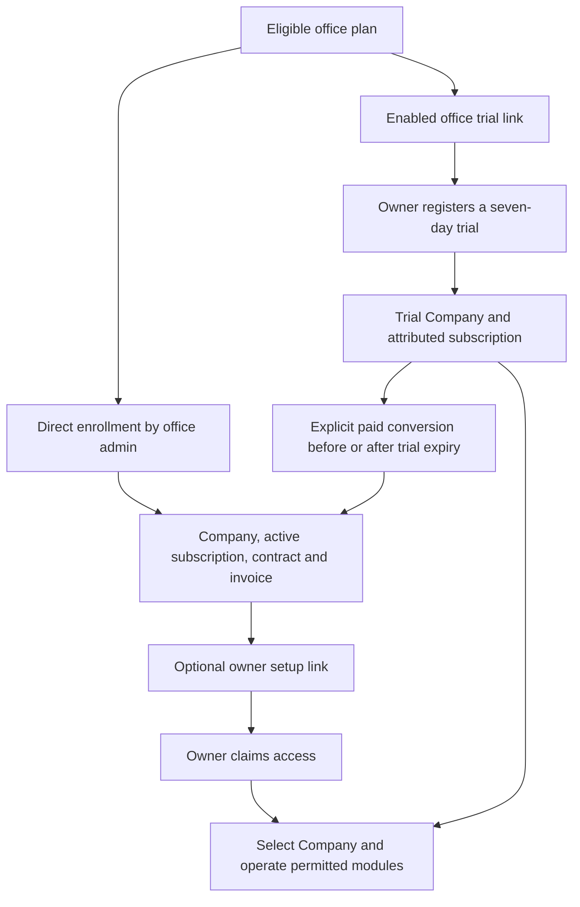

# Local Office ERP flow readiness

Date: 2026-10-26. Application source: `83b59e5`.

The requested operating model is that an eligible office plan permits ERP management without additional local availability switches preventing enrollment or trials. This record maps the current local environment and the configuration/catalog changes applied to make those existing flows available. It is not evidence of a production rollout or of a completed customer enrollment.

## Resolved availability blockers

| Area | Observed blocker | Applied local correction | Verified result |
| --- | --- | --- | --- |
| Office plans | Basic, Professional and Enterprise plans had resale disabled, zero licences and no modules | Enabled ERP resale, unlimited licences and all eight existing modules on the three office plans | Active office subscription has current resale/provisioning capabilities |
| Technical ERP catalog | The catalog was empty; enrollment returned `no_eligible_erp_plan` | Initialized `basic` / `Básico ERP` using `ErpCommercialCatalog::ensureBasicPlan()` | One eligible technical plan with all eight modules; enrollment `can_provision=true`, `reasons=[]` |
| Public registration | The local availability flag was off | Enabled the existing local registration setting | Real HTTP registration-status response: 200, `registration_available=true`, `platform_ready=true` |
| Office-attributed trial registration | The local trial availability flag was off | Enabled the existing local office-trial setting | Current office can start a trial |
| Office trial link | No link was configured for the office | Configured and enabled its link through `OfficeErpTrialLinks::configure()` using the eligible technical plan | Real public HTTP response: 200, `available=true`, `reason=null`, `duration_days=7` |
| Reports and accounting delivery | Preview was restricted to a single Company/user pair | Retained preview mode and broadened its local allowlist to all otherwise authorized contexts | Runtime release gate admits multiple distinct Company/user pairs |
| Long-lived processes | The running HTTP server still reported the old registration availability after the environment edit | Restarted backend, queue and scheduler | Fresh HTTP responses reflect the new settings |

The office plan catalog (`plans`) and technical Company plan catalog (`erp_plans`) are separate. Enabling the first does not populate the second. The enrollment warning was caused by the empty technical catalog after the office-plan restrictions had already been resolved.

## Local configuration

| Setting | Current local value |
| --- | --- |
| `ERP_REGISTRATION_ENABLED` | `true` |
| `ERP_OFFICE_TRIAL_ENABLED` | `true` |
| `ERP_OPERATING_WRITES_ENABLED` | `true` |
| `ERP_RELEASE_MODE` | `preview` |
| `ERP_PREVIEW_ALLOWLIST` | `[{}]`: every context that passes existing Company authorization |
| `ERP_RELEASE_ENABLED` | `false`: production release mode was not selected |
| `ERP_FISCAL_PRODUCTION_ENABLED` | `false` |
| Fiscal provider | `fake` |

Only the listed commercial availability entries were edited in the ignored local backend environment. Other environment entries were checked for exact preservation. Private backups retain the prior environment and plan state; credentials and trial-link codes are omitted from this report. The checked-in example defaults remain unchanged.

## Complete flow and remaining business prerequisites

| Step | Current readiness / required action | Existing owner of the rule |
| --- | --- | --- |
| Selected office | Current office is active; its current subscription is active and its operator has a real admin membership | `ResolveOfficeErpCommercial`, `OfficeErpAdmission` |
| Capacity/modules | ERP licences are unlimited; the office allowance and technical plan contain all eight modules | `OfficeErpAdmission`, `OfficeErpCustomerEnrollment::plans` |
| Existing portfolio client | One active Company client is available, with tax ID and tax regime, and no existing ERP Company association | `OfficeErpCustomerEnrollment` |
| New portfolio client | Existing plan client quota still applies: the current Basic office plan allows 50 clients and currently has one. Company tax ID and tax regime must be valid | `PlanLimits`, `ClientManager`, enrollment validation |
| CNPJ consultation | New-client preparation uses the existing CNPJ provider. Its live availability was not tested. Enrollment of an existing portfolio client does not need that new-client lookup | `ClientManager::prepareCompanyRegistration` |
| Commercial terms | The operator supplies canonical decimal price, BRL currency, an allowed billing interval, due days, timezone, and a start date no later than today | `OfficeErpCustomerEnrollment::validate` |
| Existing Company/CNPJ | An existing Company requires explicit association with its current owner; enrollment must not silently take it over | Enrollment and Company authorization services |
| Owner setup | Enrollment can finish before owner setup. A person who will operate the Company claims the issued access link; existing identities sign in with the intended email | `OfficeErpOwnerSetup` |
| Office access to Company operations | Office commercial administration does not itself grant a Company membership. An owner can explicitly delegate Company access to the office | `ErpCompanyAuthorization`, `CurrentCompany` |
| Company selection and permissions | Select the Company in the session. Requests retain the current Company assertion and effective action/establishment permissions | `ResolveCompany` |
| Operating contract | A directly enrolled Company receives its active subscription through the existing enrollment transaction. A trial operates for seven days and uses explicit conversion for paid continuity | `OfficeErpContracts`, `ErpCommercialGate`, `ErpTrialLifecycle` |
| Standalone public signup | The separate, unattributed public signup route is now available locally, but still creates a **pending** subscription. Use office enrollment or the attributed trial link for the complete office-plan flow | `ErpCommercialRegistration`, `ErpCompanyProvisioning` |
| Reports/accounting | The local preview restriction no longer limits a particular Company/user pair. Effective read/write permissions and subscription rules still apply | `ErpReleaseGate`, `ResolveCompany` |
| Fiscal production | Real production dispatch still requires its separate issuer/certificate/provider/canary setup. The commercial release does not authorize real fiscal transmission | `ErpFiscalProductionGate` |
| Background processing | Backend, queue and scheduler were restarted. Existing invoice-generation, trial-expiry and accounting-outbox schedules remain configured | `routes/business-console.php` |
| Unknown command outcome | Use the existing operation lookup before repeating enrollment or conversion; idempotency/recovery remains part of the normal flow | `OfficeErpOperations` |

These identity, data-integrity and contract requirements are not additional rollout switches. No memberships, customer contracts, customer invoices, passwords or trial registrations were manufactured to claim readiness.

## Verification

- Fresh PostgreSQL-backed application reads confirmed the real office allowance, compatible technical plan, enrollment eligibility and enabled/publicly available trial link.
- Real GETs through the running frontend proxy returned 200 for public registration availability and office-trial availability. The first registration check correctly caught the stale long-lived server environment; it passed after backend restart.
- `FISCAL_ENVIRONMENT=producao vendor/bin/phpunit tests/Feature/OfficeErpCommercial/CustomerEnrollmentTest.php tests/Feature/OfficeErpCommercial/OwnerSetupTest.php tests/Feature/OfficeErpCommercial/CommercialAdmissionTest.php`: exit 0, 37 tests, 266 assertions.
- The additional TrialLink, TrialRegistration and ErpReleaseLaunchAcceptance group ran 32 tests: 31 initially passed; one fiscal test could not generate its synthetic RSA key because the host PHP OpenSSL default configuration path did not exist. A minimal RSA-generation probe reproduced the environment error, and setting `OPENSSL_CONF=/etc/ssl/openssl.cnf` before PHP startup resolved it.
- The affected `test_production_erp_release_does_not_broaden_fiscal_provider_scope` passed on focused rerun with the explicit OpenSSL configuration. It verifies that commercial release does not broaden fiscal production scope.
- PHPUnit used the existing forced in-memory SQLite test configuration, array sessions/cache and synchronous queues. These tests are not PostgreSQL concurrency or live-provider acceptance.
- This task changed local configuration/catalog/link data and this report. No application-source, dependency, schema or checked-in environment-example change was required. No frontend build or new browser enrollment journey was run.
